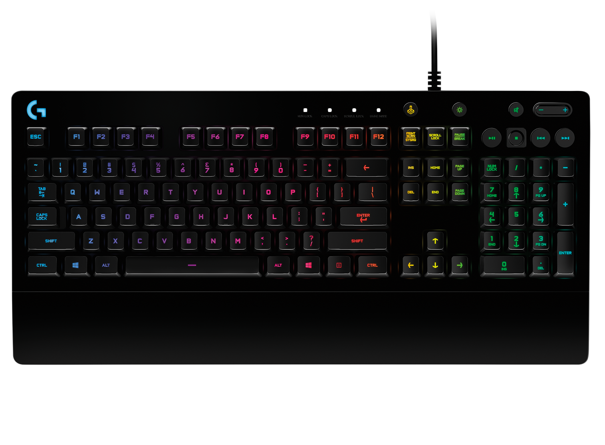

# G213 RGB

Controle de iluminação do **Logitech G213 Prodigy** no Linux, feito em Rust.
Uma aplicação local, em português, com design inspirado no
[OpenLogi](https://github.com/AprilNEA/OpenLogi): galeria de dispositivos,
imagem do produto, navegação por abas e ajustes junto à prévia do teclado.



## O que você pode fazer

- Personalizar uma cor uniforme ou cada uma das **cinco zonas RGB**.
- Selecionar zonas no diagrama ou nos botões numerados, com cor hexadecimal,
  controles RGB, paleta de cores e cópia de uma cor para todas as zonas.
- Usar efeitos nativos: estático, respiração, ciclo, onda ou desligado.
- Ajustar velocidade e direção da onda, com uma simulação animada na interface.
- Ajustar brilho em estático e respiração. **Ciclo e onda definem suas próprias
  cores e brilho no teclado**; nesses efeitos, a interface só oferece os
  controles que funcionam.
- Criar até 32 perfis locais com nomes próprios; selecionar, excluir e desfazer
  a última exclusão. Quatro presets estão incluídos: Aurora, Foco, Oceano e
  Espectro. Os perfis guardam a iluminação, sem alterar o tema da interface.
- Desfazer a última alteração de iluminação e restaurar a iluminação padrão.
- Escolher tema claro, escuro ou do sistema.
- Preparar configurações com o G213 desconectado e aplicá-las automaticamente
  quando ele se conectar. O aplicativo também detecta desconexões em repouso.
- Ver avisos de conexão, permissão e falha de salvamento na própria interface.

A foto identifica o produto; o diagrama separado simula a iluminação e não
representa uma leitura do estado físico dos LEDs. A edição de cores ou zonas
ativa o efeito estático. O interruptor de iluminação preserva o último efeito.

**Esc** volta para os dispositivos (ou fecha um modal). **Ctrl+Z** desfaz a
última alteração de iluminação, exceto enquanto um campo de texto está em uso.
Os sliders também aceitam as setas do teclado quando recebem foco.

## Escopo e referência

Esta versão é exclusiva para o **G213 USB (`046d:c336`)**. O teclado tem cinco
áreas de iluminação, não RGB individual por tecla. Remapeamento de teclas,
macros, perfis automáticos por aplicativo e outros dispositivos não estão
implementados. As funcionalidades do OpenLogi dependem do hardware; aqui os
controles respeitam as capacidades documentadas do G213.

A identidade do aplicativo é própria. Não há afiliação com OpenLogi ou Logitech.
Nenhum recurso exige conta, telemetria ou download de imagem em tempo de execução.

## Compilar e executar

Requisitos: Linux com X11 ou Wayland e OpenGL; **Rust 1.95 ou mais recente**,
conforme o requisito do egui 0.36. Instale as ferramentas de compilação C e as
bibliotecas de desenvolvimento do ambiente gráfico da sua distribuição.

```sh
cargo build --locked --release
./target/release/g213-rgb
```

Para conhecer a interface sem acessar o hardware nem modificar sua configuração:

```sh
cargo run --locked -- --preview
```

O modo de prévia começa com a configuração padrão e descarta as alterações ao
fechar. Para controlar o dispositivo, execute sem `--preview`.

Na primeira execução pode ser necessário liberar o acesso a `/dev/hidraw*`:

```sh
./install.sh
```

O instalador solicita `sudo`, instala `/etc/udev/rules.d/60-g213-rgb.rules` e
recarrega as regras. **Desconecte e reconecte o teclado** depois da instalação.
A regra utiliza `uaccess` para permitir acesso pela sessão local do usuário;
o aplicativo funciona sem root.

## Configuração e perfis

As alterações são salvas automaticamente em
`$XDG_CONFIG_HOME/g213-rgb/config.json` ou `~/.config/g213-rgb/config.json`.
O salvamento usa um arquivo temporário seguido de renomeação. Configurações da
versão anterior continuam compatíveis; perfis são acrescentados ao mesmo JSON.

Para fazer backup ou transferir os perfis, copie esse arquivo com o aplicativo
fechado. Os perfis são salvos no computador, não na memória interna do teclado.
Se houver falha ao salvar, a barra inferior informa o erro e a aba Dispositivo
exibe o detalhe. Mudanças de tema ou criação de perfis não reenviam comandos RGB.

## Linha de comando

| Comando | Ação |
| --- | --- |
| `g213-rgb` | Abre a interface. |
| `g213-rgb --preview` | Explora a interface sem hardware ou salvamento. |
| `g213-rgb --diagnose` | Localiza a interface HID e testa o acesso. |
| `g213-rgb --profiles` | Lista perfis locais e predefinidos. |
| `g213-rgb --profile "Aurora"` | Aplica um perfil e salva a seleção após sucesso. |
| `g213-rgb --apply` | Reaplica a configuração salva. |
| `g213-rgb --test` | Envia cinco cores distintas para testar as zonas. |
| `g213-rgb --off` | Apaga a iluminação sem alterar a configuração salva. |
| `g213-rgb --help` | Mostra a ajuda. |

Use a CLI com a interface gráfica fechada para evitar que dois processos
escrevam no dispositivo ou no mesmo arquivo de configuração. `--profile`
preserva a configuração se o teclado não for encontrado ou a aplicação falhar.
`G213_HIDRAW=/dev/hidrawN` permite indicar manualmente a interface de controle.

## Desenvolvimento e validação

```sh
cargo fmt --check
cargo clippy --locked --all-targets -- -D warnings
cargo test --locked
cargo build --locked --release
```

Os testes cobrem pacotes HID, desconexão em repouso, leitura de configurações
antigas, perfis, validação hexadecimal (incluindo Unicode), simulação dos efeitos
e fluxos de interação da interface sem hardware. A prévia permite conferir
as telas sem enviar comandos ao teclado. A validação dos efeitos físicos
continua dependendo de um G213 conectado e com acesso liberado.

| Arquivo | Responsabilidade |
| --- | --- |
| `src/app.rs` | Navegação, edição de iluminação, estado da interface e modais. |
| `src/app/profiles.rs` | Tela de perfis locais. |
| `src/config.rs` | Configuração, snapshots de iluminação, presets e persistência. |
| `src/device.rs` | Descoberta, protocolo HID e comunicação em segundo plano. |
| `src/product.rs` | Carregamento da imagem incorporada do produto. |
| `src/keyboard.rs` | Simulação interativa das cinco zonas. |
| `src/theme.rs`, `src/widgets.rs` | Paleta, tipografia, ícones e controles. |
| `udev/60-g213-rgb.rules` | Regra de acesso ao dispositivo. |

## Protocolo e créditos

O G213 expõe uma interface HID vendor-specific (usage page `0xFF43`, report ID
`0x11`) com relatórios de saída de 20 bytes. A implementação segue o protocolo
registrado no [controlador G213 do OpenRGB](https://github.com/CalcProgrammer1/OpenRGB/tree/master/Controllers/LogitechController/LogitechG213Controller).

A organização visual e a paleta tomam o [OpenLogi](https://github.com/AprilNEA/OpenLogi)
como referência. Não são redistribuídos seu nome como marca do aplicativo,
logotipo ou ícone.

Código sob MIT. Inter usa a SIL Open Font License 1.1 (veja
`assets/fonts/LICENSE-Inter.txt`) e Phosphor usa MIT. A fotografia e as marcas
do produto pertencem à Logitech e não fazem parte da licença MIT do código;
consulte [a origem da imagem](assets/devices/README.md).
